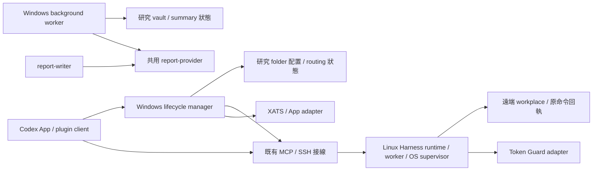

# 結構定版建議與工程量

日期：2026-10-11（Asia/Taipei）。這份文件把[選型研究](FRAMEWORK_AND_STANDALONE_PROJECT_20261010.md)收斂為可執行的結構設計，補充盤點 (local provenance omitted)。以下是**推薦設計與初步工程估算，未實作**。本轮只更新文件，沒有搬檔、提交、安裝或改動運行設定。

後續修復、升版、相容、依賴同步、配置／資料遷移與多端啟用的具體規則，見[更新與維護原則](UPDATE_AND_MAINTENANCE_POLICY_20261011.md)。其實作已列入 S1–S7 工程範圍。

**2026-10-11 最新執行順序：** 依[独立組裝任務書](PROJECT_EXTRACTION_TASKBOOK_20261011.md)，先獨立來源／構建，驗收後上傳私人 GitHub 基線，再落實本文件的正式結構，最後切換現用入口。S1–S7 是工作包估算，具體排序以任務書 A–D 為準。

## 1. 結構與工具的明確選擇

**推薦定版：獨立 solution-agent project，一個 Git repo、明確模組邊界、按進程與部署責任出包。模組內保留現用程式，模組之間透過公開接口連接。** 共用系統程式歸這個 project；研究 folder 保存研究程式、配置、原文及狀態，從受管安裝入口使用系統。

| 面向 | 採用的方案 | 要落實的界線 |
| --- | --- | --- |
| 開發與構建 | Nx task graph + 明示 project.json | 統一 lint/test/build/package 入口；Python／跨語言邊由配置明確宣告，不依賴未知自動推導。Nx 不参与研究派工 |
| Python runtime | 現有 Python + Pydantic + MCP，uv 管 metadata/lock，Hatchling 打 wheel | 現有 `solution_agent` namespace 保留；正式 package 不依賴研究 checkout 或系統全域 site-packages；CLI 為公開入口 |
| Node runtime | 現有 Node 24 + TypeScript/ESM；pnpm workspace；esbuild 打包 | router、provider、writer、background 各宣告 package exports；原生 SQLite 依平台打包，不塞入 esbuild 以假裝可攜 |
| 狀態儲存 | 沿用各元件現有 SQLite／磁碟回執 | Harness、router、background 各自的狀態權威明确；不合併三個 DB，不以程式更新覆蓋狀態 |
| 接口 | 現有 MCP／CLI／RPC + 版本化 schema | 只整理與穩定化既有接口；保留 Artifact Clipboard、command ID、lease/CAS/provenance；App/XATS 為明確 adapter |
| 架構檢查 | TS 的 package exports/Nx ESLint boundaries；Python Import Linter；跨語言 contract tests | 非法跨模組 import、研究絕對路徑直連、未宣告副本環境要在檢查中失敗 |
| 版本／發布 | 一份系統 release plan + 既有 builder 擴充生成 release manifest | manifest 指定測過的各元件版本／hash；Nx 編排構建，既有 builder 是本系統的發布權威；Python/Node/plugin metadata 一致性有檢查 |
| 安裝／同步更新 | 既有 overlay/deployment helpers 擴充一個維護入口 | 同一 release 計畫涵蓋 local client、manager、remote runtime、worker；逐端 receipts、中斷接續及回退 |

Nx 可執行自訂語言命令，官方有 Python + uv 範例；這次使用顯式 targets，避免為接入 Python 先寫一套 Nx 語言插件。[Nx 多語言文件](https://nx.dev/docs/features/multi-language-support)

uv 可以呼叫標準 Python build backend 產生 distribution；Hatchling 作此處的推薦 backend，實際打包 metadata、data files 及 legacy entry wrappers 在 S2 驗證。[uv distribution build](https://docs.astral.sh/uv/concepts/projects/build/)

**對前份方案的收斂：** 不將「導入 Nx Release 就能處理任意 Python/ZIP/插件」作前提。Nx 只負責開發 graph、tasks 及自身工具 migration；本系統跨語言 release 由現有 builder／manifest 工作流統一負責。可在其內使用受測試的 Nx version-plan 功能，但不得形成兩個版本權威。各工具精確 patch 版本於隔離構建驗證後鎖定，正式結構不隨普通修復更換。

## 2. 正式來源目錄

以下為**推薦的目標目錄**；Python source 的路徑調整在本次結構整理完成，import namespace 不因目錄歸位改名。apps 表示會啟動進程的程式，packages 表示被其他程式依賴的模組，plugins 表示 Codex 安裝 payload。

```text
solution-agent/                       # 獨立開發 project／單一 Git repo
  nx.json
  package.json / pnpm-workspace.yaml / pnpm-lock.yaml
  pyproject.toml / uv.lock             # 系統 Python workspace，排除研究環境
  apps/
    lifecycle-manager/                # TS：manager/router/mailbox，含 App/XATS adapters
    report-writer/                    # ESM：server/CLI、報告 schema、remote adapter
    research-background/              # ESM：補查/queue/摘要/CLI，state 由配置指向外部
  packages/
    harness-runtime/
      pyproject.toml
      src/solution_agent/             # 既有 core/Harness 公開 namespace
        contracts/                    # 由原 model 歸位／相容 export
        harness/                      # capsule/CAS/job/worker/recovery
        ...                           # 現用 core 依賴；未核准的舊功能有明確 legacy 邊界
    report-provider/                  # 唯一 DS 設定、credential/request helper
    token-guard/                      # Python guard/ledger + 舊 CLI 相容入口
    schema-bindings/                  # 生成的跨語言 schema/TS binding；不另寫第二份語義
  plugins/
    solution-agent-harness/            # plugin manifest/skills/launcher 的維護來源
    research-report-writer/
    research-token-guard/
  schemas/                            # project/config/delivery/release 等契約
  templates/                          # 非秘密 project、profile、rules 範例
  deployment/                         # build/release/update/rollback helpers
  vendor/                             # 必需 XATS/Paperclip 選定來源、patch/provenance/licenses
  tests/integration/                  # local/remote/跨語言契約與恢復演練
  docs/architecture/ / docs/migrations/
  AGENTS.md
```

**來源規則：** plugins 只維護 manifest、skills 和啟動 adapter；執行邏輯引用 apps/packages 的唯一來源。必要嵌入 plugin ZIP 的腳本由 build 複製生成，附 source hash，不能人工維護第二份。對當前 router 裡分散的 Python RPC helpers，也要歸位並透過受管 runtime 的公開 CLI/API 使用；避免兩個不完整的 `solution_agent` namespace 在 import path 中互相遮蔽。

**vendor 規則：** XATS 的選定版本與 native SQLite 依賴明確鎖定，必要本地修改保存 patch；Paperclip vendor 的 license/provenance 保留。從其正式 build 入口組裝服務，不能再從 `研究/experiments/upstream/node_modules/.pnpm/...` import builder。第三方包不合併成我們自己的任務系統。

**研究 folder：** project descriptor、local override、release lock、既有 workplace.id、research-vault、研究腳本与狀態。可以另有自己的 Git repo；不把研究 Conda/GPU 環境納入系統 uv workspace。原 runtime DB、run root 先保持位置，入口遷移不要求把資料也搬走。

## 3. 運行結構與依賴方向

這是**推薦的進程／部署圖**。圖中 Research folder 是各服務使用的配置與資料位置，並非系統維護來源。



**接口方向：** schema/contracts → runtime/client/manager；provider → writer/background；Harness 公開接口 → routing adapter；vault/delivery adapter → 研究資料。core/contracts 不反向 import writer、background、研究專案或 Codex App adapter。

**正式契約權威：** 既有 capsule/receipt 等 Python 模型保留其 schema authority，輸出 JSON Schema 給 Node 校驗；新增跨語言 project/config/delivery 契約採 schemas 中單一 JSON Schema。生成 binding 有漂移檢查。避免 Python 和 TS 各手寫一份「差不多」的相同契約。

**既有功能分工：** `research_md_snapshot/research_md_sync_plan` 仍是只讀比較；`task_md_sync` 仍是原 command 的版本化任務傳送；背景服務仍整理已在本地 Sources 的文字。這次結構整理涵蓋它們的共用程式、配置和契約，不增加遠端無人值守取回或 vault 全面雙向同步功能。

## 4. 最後交付的安裝元件

| 交付元件 | 部署位置／進程 | 從哪些正式來源生成 |
| --- | --- | --- |
| local Harness client plugin | Windows personal plugin 的受管入口；經原 MCP/SSH 接線 | plugins/harness + runtime/client adapter；不借研究 tools 的 venv |
| local lifecycle manager | Windows Node 服務；保持 SessionStart 接回 | apps/lifecycle-manager + 選定 XATS/vendor；程式與 DB 分開 |
| remote runtime + worker plugin | Linux 既有 solution_agent_root 與原 run root | packages/harness-runtime + worker plugin payload；OS job supervision 沿用 |
| report-writer plugin | 受管 Node MCP/CLI；remote adapter 視 profile 接入 | apps/report-writer + packages/report-provider |
| background service | Windows 登入排程 + GUI launcher，獨立於 App/Obsidian | apps/research-background + provider；各研究 folder 的配置/DB 分離 |
| Token Guard plugin/tool | 本地／遠端宣告的入口 | packages/token-guard + plugin skill/CLI payload |

**升級入口的定義：** 一個維護 CLI 提供 status、plan、apply、verify、rollback 行為，內部沿用現有 deployment IDs／helpers／receipts；命令名稱在接口定版時固定。plan 必須列受影響 host/project binding、當前／目標 release/hash、衝突、相容要求與需要的資料 migration。apply 逐端保存回執，resume 查原回執；不能重新派研究工作。

**同步更新的完成標準：** 所選全部 targets 的 manifest/hash/schema/入口啟用檢查通過，才能標為完整；部分完成保留每端結果。全域 personal plugin 變更要檢查該主機所有受影響 project；活躍 session 的 reload/啟用不能省略。活躍 OS command 保留原 execution release 与原身份，回退不覆蓋活動 DB。

## 5. 工程量的證據基礎

**2026-10-11 本地只讀量測：** 以下是文字行數，含註解，不代表全部需重寫，也不代表所有舊功能要維護。部分範圍重疊，不能相加宣稱總工作量。

| 區域 | 檔案／行數 | 對工作量的意義 |
| --- | --- | --- |
| S/solution_agent 全部 Python | 178 檔／76,827 行 | 整套副本規模；範圍歸類是第一關，不整庫重寫 |
| 其中 Harness | 40 檔／10,344 行 | 身份、lease/CAS、worker recovery 的兼容回歸主要工作 |
| 其中 continuation | 49 檔／31,414 行 | 大量早期能力；依現用依賴界定保留／legacy，不能一律要求改造 |
| S/scripts/harness | 19 檔／3,014 行 | 有可重用 builder/installer，需接正式 package/layout/lock |
| router manifest 的 TS/Python 正式輸入 | 40 檔／2,697 行 | 4 檔來自 goal-routing-integration，36 檔來自 routing-sandbox；未計第三方依賴及全部測試 |
| installed writer 的 ESM | 5 檔／777 行 | 含一個 test-named 檔；主要是 provider 抽取、API/模型契約与打包 |
| Token Guard scripts | 5 檔／3,079 行 | CLI、receipt/ledger 的獨立打包及舊技能入口兼容 |
| background 的 mjs/ps1/cs/vbs | 11 檔／1,097 行 | 含測試/fixture；配置、provider import、state root 和 launcher 安裝規則需歸位 |

S 指 `C:/Users/example-user/Desktop/example-research/experiments/harness-routing-sandbox`。再次核對 installed release manifest 的 122 個 Python 程式／測試：S 122/122 符合，現有 core repo 39 符合、49 缺少、34 不同；因此需逐檔收斂来源。這不是今天重新驗收遠端 runtime。

**另一個已確認的成本來源：** `研究/tools/solution-agent-harness/.venv/pyvenv.cfg` 記錄 Python 3.13.12、`include-system-site-packages = true`。現用 runtime 可能借全域套件；需在獨立環境查明依賴，不可只複製 requirements 就宣稱可重建。Linux Python 小版本、XATS native ABI 及現有完整部署 package inventory 仍需在落地前核對。

## 6. 分階段工作量

**初步估算／中等信心：** 以一名熟悉現況的工程師之有效工程人日為單位，包含實作、審查、對應測試及遷移驗收。1 人日約 6–8 小時有效工程工作。不是按行數乘時間，也不是 Codex 工具運行時間或完成日承諾。範圍是現用 Windows manager + 一個 Linux workplace 的完整標準化與更新流程；第二個真實研究 folder 接入驗證另列。

| 工作包 | 工程人日 | 具體完成物／驗收 |
| --- | ---: | --- |
| S1 來源權威與依賴 closure 定版 | 2–3 | 逐檔 source→module→artifact 對照；需維護/legacy 清單；locks/runtime 需求與接口凍結 |
| S2 正式目錄、package、構建圖與邊界 | 4–6 | Python wheel、Node packages、Nx targets、uv/pnpm locks、vendor build；來源可獨立構建，非法依賴被檢查拒絕 |
| S3 provider／配置／跨語言契約歸位 | 2–3 | 唯一 provider、相容 exports、project/schema/override loader、生成 binding與consumer tests；固定現用模型 |
| S4 統一 release 與多端更新/回退 | 3–5 | manifest/metadata 一致；現有 deploy helper 接維護入口；衝突與部分失敗/中斷接續回執 |
| S5 集成回歸及隔離遷移演練 | 3–5 | 身份/lease/CAS/command recovery、App/XATS 接回、native SQLite、background 停啟／去重的有效驗收 |
| S6 現用系統切換與版本一致性核對 | 2–4 | local plugin、manager、remote runtime/worker、background 受管入口驗收；原 state/identity 不丟；實際回退能力 |
| S7 Git／CI／維護規則及交付文件 | 1–2 | 白名單提交、來源恢復點、CI checks、AGENTS/架構規則、私人 GitHub 推送與release配置（僅在授權後操作） |
| **基礎合計** | **17–28** | 所有 S1–S7 完成才算整體標準化完成 |
| **約 25% 不確定性餘量後的預算** | **約 21–35** | 安裝來源分叉、native/module環境、App session 接回及實際狀態相容問題 |

因此，**推薦用 21–35 人日作工程預算**；若一週按 5 個人日排程，單人約 **4–7 個工作週**。Codex 可縮短部分機械搬移／配置／測試編寫，但其實際日曆時間受驗收、長任務、安裝切換與使用者研究節奏影響，目前不能把人日估算承諾成幾小時或幾個 chat 回合。

**範圍與增量：** 不把全部 76k 行舊 core 重寫成新框架；確實使用的舊入口要納入來源与兼容清單。新增完整遠端無人值守收件／vault 雙向同步、重做研究調度算法、全面改 DB schema、其他 OS 支援，都需另估。第二個真實研究 folder／workplace 接入大約再 **1–2 人日**，前提是不用改 protocol；第二個空白合成 project 的隔離測試已含 S5。

## 7. 主要不確定性與先做哪一步

| 不確定性 | 影響 | 最早解除的證據 |
| --- | --- | --- |
| 全域 Python 依賴與 Linux interpreter | 新打包是否真的可重建，可能需要補 metadata/native wheel | S1/S2 的獨立環境構建，不借 live venv |
| XATS/vendor/SQLite 與 App adapter | manager 能否從固定 source 重建、接回原身份 | S2 的 native build；S5 的原身分／合成queue接回 |
| core 仍在用的入口清單 | 不明確會把大量 legacy 範圍算進改造 | S1 的 dependency closure 和入口映射，對未確認入口保留記錄 |
| 活躍工作與全域 plugin 切換 | 舊 session 未reload、跨版本不相容或不同研究 binding衝突 | S4 的 update plan；S6 的實際 session/manifest gate |
| 契約／schema 本身的隱含差異 | 僅搬檔會保留歷史分叉；修正可能需要 migration | S3 的權威模型与雙語consumer測試；S5 演練 |

**推薦下一個可驗收單位是 S1**：輸出逐檔遷移表、依賴 graph、正式 API/schema 清單與锁定環境方案；以這份具體設計校正 S2–S6 的估算。S1 是完整工程的第一階段，不能把它完成視為標準化已交付。這份文件把架構和預算說明清楚，仍遵守原本只盤點／討論、不修改現用系統的界線。
